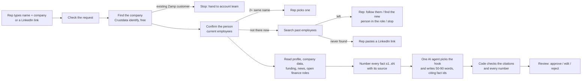

# Footnote

**Personalised outreach where every sentence has a source.**
Zamp ASA case study, PS-3 (prospect → research → hook → draft → human review). Built by Nitin Gupta.

You type a prospect's name and company. Footnote looks them up in Crustdata, picks the one reason to write
to them now, drafts a short email, and links every factual sentence to the fact it came from. A person
approves, edits or rejects it. Nothing is ever sent automatically.

- **Live app:** https://footnote-qz8g.onrender.com (free hosting: the first visit after a quiet spell takes about a minute to wake up)
- **Test results:** [docs/EVAL.md](docs/EVAL.md), 11 of 11 cases pass

## How it works



Each step is shown live while it runs, with what it found and why it decided what it did.

## Why it's built this way

| Choice | Why |
|---|---|
| **Crustdata, not web search** | Structured people and company records give the real current job, past employers, funding, headcount and open roles. Web search can't reliably tell you that someone changed jobs, or tell two people with the same name apart. |
| **One AI agent with one clear rulebook** | Research shows the simplest setup that works is the most reliable. The agent sees all the facts at once and picks the hook the way a good SDR would. Its rulebook ([seller.py](backend/app/seller.py)) is based on cold-email research: 50-90 words, plain words, one idea, the problem asked as a question, one customer proof, and an interest question ("Worth a look?") instead of a meeting ask. |
| **Code checks the AI** | The AI suggests and code verifies. Every factual sentence must cite a real fact id. Every number must appear in what it cites. Sales clichés and over-length drafts are flagged. |
| **The email fits the business** | A lender gets loan collections and the close. A retailer gets supplier invoices and new countries. The customer proof is the closest match, or is left out entirely. |
| **A human decides** | Approve, edit (the original is kept) or reject with a reason. The dashboard tracks approval rate, % of sentences with a source, and time to draft. |
| **Fresh data, controlled cost** | Every prospect is looked up live in Crustdata and written fresh by Gemini; nothing is reused from earlier prospects. Within one run an answer is reused, so picking a person doesn't pay twice. There is a credit cap per run (6), so one broken run can't spend much. Finding the company is free. Same-name and not-found searches cost nothing, because searches are billed per result returned. |

## Edge cases it handles on purpose

| Case | What happens |
|---|---|
| Two people with the same name at the company | Pauses and shows both profiles. The rep picks one. |
| The person left the company | Shows when they left and where they went. The rep chooses: follow them to the new job, write to whoever holds the role now, or stop. |
| Person not found | Asks for a LinkedIn link instead of guessing. |
| Many companies share the name (25 called "Zipline") | The person's current employer decides which one. The choice is shown as a check. |
| Existing Zamp customer | Stops before any paid lookup and routes the prospect to the account team. |
| Typed title differs from the profile | Uses the profile's title and flags the difference. |
| Bad news (layoffs, lawsuits, losses) | Never used as a hook. Shown as "left out" so the rep sees it was found. |
| Job post for the prospect's own role | Never used ("you're hiring my replacement" is awkward). |
| Sources disagree on a number (a funding amount) | The number is left out. The email names the round or investor instead. |
| Story covered by many outlets | Used later or not at all, because every other rep opens with it. |
| Prompt injection in notes or news | Source text is wrapped and marked as untrusted data. Tested: an "ignore all instructions" note does not reach the email. |
| AI times out or returns broken output | Retries, then a backup model. A backup-written draft is flagged "Review with care". An incomplete answer is never shown as a draft. |
| Same person drafted in the last 30 days | Warns before writing again. |
| Bad input (a company page link, first name only) | Stopped with a plain explanation. |

## Run it locally

```bash
python3 -m venv .venv && .venv/bin/pip install -r backend/requirements.txt
cd frontend && npm ci && npm run build && cd ..
cp .env.example .env    # add your Crustdata and Gemini keys
cd backend && ../.venv/bin/uvicorn app.main:app --port 8000
```

Open http://127.0.0.1:8000. Run the test set with `cd backend && ../.venv/bin/python -m tests.eval`.

## Code map

- `backend/app/pipeline.py`: the steps, the questions to the rep, and the code checks
- `backend/app/seller.py`: who Zamp is, its customer proofs, and the agent's rulebook
- `backend/app/crust.py`: Crustdata calls, the answer cache and the credit caps
- `backend/app/llm.py`: Gemini, with DeepSeek as backup
- `backend/app/main.py`: the API and the live stream
- `frontend/src`: React screens (new prospect, live run and review, dashboard)
- `backend/tests/eval.py`: the test set

## Limits

- One prospect at a time. There is no CSV batch upload yet.
- The free hosting plan resets the run history on each deploy, back to the recorded example runs.
- The proof points are Zamp's published customer results. A real deployment would read customers and do-not-contact lists from the CRM.
